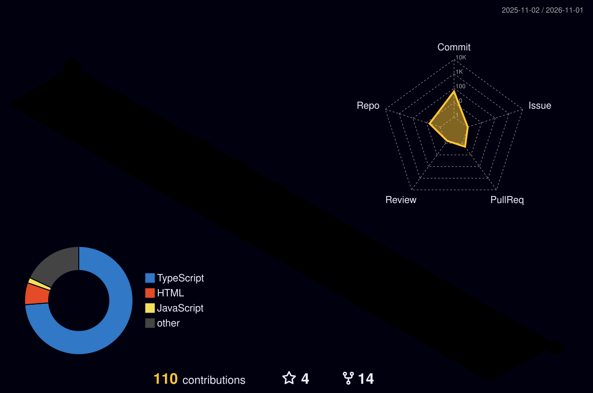

<!-- ═══════════════════════════ HEADER ═══════════════════════════ -->
<p align="center">
  
</p>

<p align="center">
  <a href="https://github.com/bharat-dussa">
    
  </a>
</p>

<p align="center">
  <a href="https://www.linkedin.com/in/bharat-dussa/"></a>
  
  
</p>

---

## ⚡ TL;DR

```ts
const bharat = {
  role:        "Senior React Native Engineer",
  domain:      "Fintech — payments, auth, KYC, secure networking",
  experience:  "5.9+ years", // auto-updated below
  ownership:   ["Mobile architecture", "Networking layer", "Perf budgets", "Design docs & ADRs"],
  learning:    ["System Design", "Backend (Go)", "DSA"],
  openTo:      "Senior / Lead mobile roles",
};
```

## 💼 Experience: <!--EXPERIENCE_START-->5.9+ years<!--EXPERIENCE_END-->

<table>
<tr>
<td width="50%" valign="top">

### 🏗️ What I own
- **Mobile architecture** — scalable React Native codebases, module boundaries, shared hooks
- **Secure networking** — SSL/TLS pinning, token refresh, retries, error normalization
- **Fintech flows** — auth, onboarding, payments, sensitive-data handling
- **Performance** — startup time, re-render audits, perf budgets in CI

</td>
<td width="50%" valign="top">

### 🧭 How I work
- Turn messy requirements into **written design docs** before code
- Record trade-offs as **ADRs** so decisions outlive the meeting
- Partner with backend & product on **API contracts**, not just screens
- Mentor through **review**, not rewrites

</td>
</tr>
</table>

---

## 📦 Libraries I've Built

<table>
<tr>
<td width="50%" valign="top">

### 🧠 [react-smart-utils](https://github.com/vituarvom/react-smart-utils)
Lodash-style library of React hooks & utilities for real production problems. Also published under the scoped name [`@rsujs/core`](https://www.npmjs.com/package/@rsujs/core).

<a href="https://www.npmjs.com/package/react-smart-utils"></a>
<a href="https://www.npmjs.com/package/@rsujs/core"></a>
<a href="https://github.com/vituarvom/react-smart-utils"></a>

```bash
npm i react-smart-utils
```

`TypeScript` `Hooks` `Tree-shakeable`

</td>
<td width="50%" valign="top">

### 💀 [@rsujs/dynamic-skeleton](https://www.npmjs.com/package/@rsujs/dynamic-skeleton)
Dynamic skeleton screens that auto-adapt to your React UI in real time — measures rendered layout and generates matching shimmer placeholders. No hand-drawn skeleton per screen.

<a href="https://www.npmjs.com/package/@rsujs/dynamic-skeleton"></a>


```bash
npm i @rsujs/dynamic-skeleton
```

`React` `Skeleton` `Shimmer` `Zero-config`

</td>
</tr>
</table>

---


## 🧊 3D Contribution Graph

<p align="center">
  <picture>
    <source media="(prefers-color-scheme: dark)" srcset="./profile-3d-contrib/profile-night-rainbow.svg" />
    <source media="(prefers-color-scheme: light)" srcset="./profile-3d-contrib/profile-gitblue.svg" />
    
  </picture>
</p>

---

## 🧰 Core Stack

<p align="center">
  
  <br/>
  
  <br/>
  
</p>

<p align="center"><sub>React Native • Expo • TypeScript • Redux Toolkit • React Query • Jest • Reanimated</sub></p>


---

<p align="center">
  <i>Debugging is better with chai ☕</i>
</p>

<p align="center">
  
</p>
